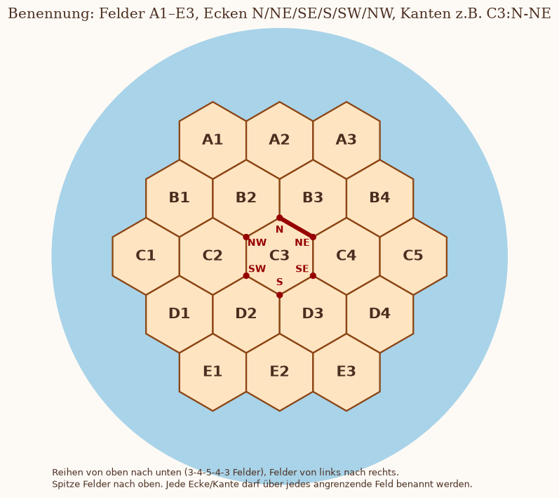

# Brett-Erfassung (Foto → Pre-Game-Daten)

Ziel: Aus einem Foto des fertig gesetzten Bretts die Pre-Game-Spalten von `catan_data.xlsx` berechnen.
Das passiert in zwei Schritten:

1. **Erkennen:** Claude beschreibt das Foto als JSON (Felder, Häfen, Gebäude, Straßen), siehe unten.
2. **Rechnen:** `catan_board.py` berechnet daraus alle Werte und zeichnet eine Skizze zum Abgleich mit dem echten Brett.

Gerechnet wird also nie im Kopf, sondern nur in `board.py`. Fehler können damit nur bei der Erkennung entstehen, und die zeigt die Skizze.

```
python ingest/catan_board.py brett.json --order PF,MF,JHC --png skizze.png
python ingest/catan_board.py brett.json --json             # Werte als JSON (für den Excel-Schritt)
python ingest/catan_board.py --reference referenz.png      # Bild der Benennung
python ingest/test_board.py                                # Tests
```

## Benennung



- **Felder:** Es gibt 19 spitze Sechsecke in waagerechten Reihen A–E mit 3-4-5-4-3 Feldern, von links nach rechts nummeriert (A1–A3, B1–B4, C1–C5, D1–D4, E1–E3). Die Wüste in der Mitte heißt C3.
- **Ecken:** Eine Ecke schreibt man `Feld:Ecke` mit der Ecke N, NE, SE, S, SW oder NW, zum Beispiel `B2:S`. Grenzt eine Ecke an mehrere Felder, darf man jedes davon nehmen: `B2:S`, `C2:NE` und `C3:NW` sind dieselbe Ecke.
- **Kanten:** Eine Kante (für Straßen und Häfen) schreibt man `Feld:Ecke-Ecke` mit zwei benachbarten Ecken desselben Felds, zum Beispiel `C3:N-NE`.

## JSON-Format

Siehe [examples/example_board.json](examples/example_board.json).

```json
{
  "hexes":   {"A1": ["ore", 10], "...": "...", "C3": ["desert", null]},
  "harbors": [{"edge": "A1:NW-N", "type": "gen"}],
  "players": {
    "yellow": {"buildings": [{"at": "A1:SE", "type": "settlement"}, {"at": "B2:S", "type": "city"}],
               "roads": ["A2:SW-NW", "B2:S-SE"]}
  },
  "unsure": ["Zahl auf D2: 3 oder 8?"]
}
```

- **Rohstoffe:** `wood` (Holz), `clay` (Lehm), `sheep` (Schaf), `grain` (Getreide), `ore` (Erz) und `desert` (Wüste, Zahl `null`).
- **Häfen:** `gen` (3:1) oder der Rohstoff des 2:1-Hafens. Ein Hafen liegt an einer Küstenkante, nutzbar sind beide Ecken dieser Kante.
- **Spieler:** Die Farben sind fest: `yellow` = MF, `blue` = PF, `red` = JHC.
- **Gebäude:** `settlement` (Siedlung) oder `city` (Stadt). Bei Städte & Ritter setzt jeder üblicherweise 1 Siedlung, 1 Stadt und 2 Straßen.
- **`unsure`:** Hier steht alles, was auf dem Foto nicht sicher zu erkennen war. Das wird bei der Bestätigung gezielt nachgefragt.

## Anleitung: Foto → JSON

1. **Ausrichten:** Dreh das Brett gedanklich so, dass die Reihen waagerecht laufen (3-4-5-4-3) und die Felder oben spitz sind. Sind die Felder auf dem Foto oben flach, sind es Spalten statt Reihen, dann um 90° drehen. Welche der sechs Drehungen du wählst, ist egal: Alle Werte hängen nur von Nachbarschaften ab. Die Drehung muss aber für das ganze Brett gleich bleiben.
2. **Felder:** Für jedes Feld Rohstoff und Zahl notieren. Wichtig sind vor allem 6 und 9 (Unterstrich beachten) sowie die roten Zahlen 6 und 8. Prüfe die Verteilung: 4 Holz, 3 Lehm, 4 Schaf, 4 Getreide, 3 Erz, 1 Wüste; die Zahlen 2 und 12 je einmal, 3–6 und 8–11 je zweimal.
3. **Häfen:** Für jeden der 9 Häfen die Küstenkante angeben, an der seine Stege liegen, plus den Typ (4× 3:1, je 1× 2:1).
4. **Gebäude:** Für jedes Gebäude die Ecke über ein angrenzendes Feld angeben und festhalten, ob es eine Siedlung oder eine Stadt ist. Gegenprobe: Welche 1–3 Felder berührt das Gebäude? Die müssen zur gewählten Ecke passen.
5. **Straßen:** Gib jede Straße als Kante an. Sie muss an einem eigenen Gebäude hängen. Ihre Richtung entscheidet über `prox_port`.
6. **`unsure`:** Alles Unsichere aufschreiben, nicht raten.

## Regeln (von Max festgelegt)

- **Produktion:** Pro Gebäude zählen die Würfelpunkte der angrenzenden Felder: 2/12 = 1, 3/11 = 2, 4/10 = 3, 5/9 = 4, 6/8 = 5. Eine Stadt verdoppelt Lehm und Getreide. Auf Holz, Schaf und Erz bringt sie 1 Rohstoff plus 1 Handelsware (Papier, Stoff, Münze).
- **`count_num`:** verschiedene Zahlen an den eigenen Gebäuden.
- **`count_res`:** verschiedene Rohstoffe, ohne Handelswaren.
- **`sum`:** alle acht Produktionswerte zusammen.
- **`port_X`:** Ein eigenes Gebäude steht auf einer der beiden Ecken eines X-Hafens.
- **`prox_port_X`:** Eine Hafenecke ist mit genau einer weiteren Straße plus einer Siedlung erreichbar, und zwar vom Ende einer eigenen Straße aus. Es zählt nicht, wenn dafür zwei Straßen nötig wären, und auch nicht, wenn ein anderer Spieler den Weg versperrt: mit einer Straße auf dieser Kante oder mit einem Gebäude auf der Ecke oder daneben (Abstandsregel). Ist `port_X` = 1, bleibt `prox_port_X` = 0, wie in den bisherigen Daten.
- **`desert`:** `outer` (äußerer Ring), `second` (zweiter Ring) oder `center`.
